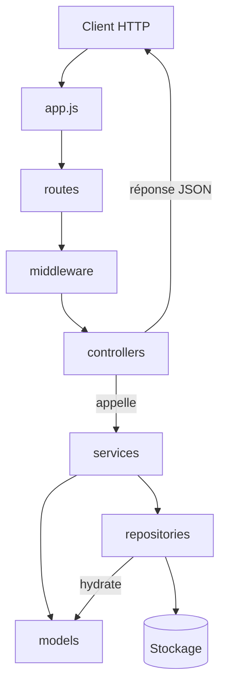

# APIs RESTful avec Node.js et Express

## Objectifs et carte de la séance

Dans cette séance, vous apprenez à **concevoir et construire une API REST** avec Express :

1. Principes REST (ressources, méthodes, codes de statut)
2. Authentification **minimale** pour une API (JWT)
3. Architecture en couches (Controller → Service → Model / Repository)
4. Mise en pratique : API simple, puis projet complet
5. Hygiène de l’API : validation, erreurs, rate limiting
6. Exercices

::: tip Sécurité avancée → séance 9
Ici on pose le **minimum** pour faire tourner une API authentifiée.
Pour HTTPS, Helmet/CSP, CORS avancé, sessions cookies, refresh tokens, menaces OWASP, etc. : voir la [séance 9 — Sécurité](./9_securite.md).
:::

---

## 1. Principes des API RESTful

REST (Representational State Transfer) est un style d’architecture pour les APIs web, introduit par Roy Fielding (2000). Il reste le standard de facto grâce à sa simplicité et sa compatibilité avec HTTP.

### 1.1 Contraintes fondamentales

1. **Interface uniforme** : ressources identifiées par des URI ; interaction via représentations (JSON) ; messages auto-descriptifs (headers, codes HTTP) ; éventuellement HATEOAS.
2. **Sans état (stateless)** : chaque requête contient tout le nécessaire (souvent un token d’auth) ; pas de session serveur obligatoire.
3. **Cacheable** : réponses marquées cachables ou non (`Cache-Control`, `ETag`…).
4. **Client-serveur** : séparation UI / logique + données.
5. **Système en couches** : proxies, gateways, caches possibles entre client et serveur.
6. **Code à la demande** (optionnel) : le serveur peut envoyer du code exécutable au client.

::: details HATEOAS en bref
Le client découvre les actions possibles via des liens `_links` dans la réponse, plutôt que d’avoir toutes les URLs en dur.

```json
{
  "id": 1,
  "name": "Alice",
  "_links": {
    "self": { "href": "/users/1" },
    "orders": { "href": "/users/1/orders" }
  }
}
```

Utile pour l’évolutivité, mais **rarement implémenté complètement** dans les API modernes si la documentation (OpenAPI/Swagger) est claire.
:::

### 1.2 Bonnes pratiques

**URLs orientées ressources** (noms, pas verbes) :

```
✅ GET /api/users — GET /api/users/123 — POST /api/users — PUT /api/users/123 — DELETE /api/users/123
❌ GET /api/getUsers — POST /api/createUser — POST /api/deleteUser/123
```

**Codes de statut HTTP :**

- **2xx** : `200 OK`, `201 Created`, `204 No Content`
- **4xx** : `400 Bad Request`, `401 Unauthorized`, `403 Forbidden`, `404 Not Found`, `422 Unprocessable Entity`
- **5xx** : `500 Internal Server Error`, `503 Service Unavailable`

**Versionnement :** `/api/v1/users` ou header `API-Version`.

**Pagination :**

```json
{
  "data": [],
  "pagination": { "page": 2, "limit": 20, "total": 150, "pages": 8 }
}
```

---

## 2. Authentification pour une API (minimum JWT)

### 2.1 Authentification vs autorisation

- **Authentification** : *Qui êtes-vous ?* (vérifier l’identité)
- **Autorisation** : *Que pouvez-vous faire ?* (permissions / rôles)

Approfondissement : [séance 9 § Authentication et autorisation](./9_securite.md#auth).

### 2.2 Pourquoi le JWT pour une API REST ?

Une API REST est souvent **stateless** : le client envoie un token à chaque requête (`Authorization: Bearer …`), sans session serveur.

| | JWT | Session + cookie |
|---|-----|------------------|
| État serveur | Non (token auto-porté) | Oui (store de sessions) |
| Scalabilité | Facile (plusieurs instances) | Plus délicate (store partagé) |
| Révocation | Plus difficile | Simple (supprimer la session) |

### 2.3 Structure d’un JWT

Un JWT a trois parties séparées par des points : `header.payload.signature`.

- **Header** : algorithme (ex. HS256), type (`JWT`)
- **Payload** : claims (`sub`, `exp`, `iat`, rôle, email…) — **encodé en Base64URL, pas chiffré** : ne jamais y mettre de secrets
- **Signature** : garantit l’intégrité avec une clé secrète

Le détail (encodage vs chiffrement, calcul HMAC, JWS / JWE) est développé en [séance 9 — Anatomie technique d’un JWT](./9_securite.md#jwt-internals).

### 2.4 Génération et vérification (essentiel)

```javascript
import jwt from 'jsonwebtoken';

const generateToken = (userId) => {
  return jwt.sign(
    { userId },
    process.env.JWT_SECRET,
    { expiresIn: '24h' }
  );
};

const verifyToken = (token) => {
  return jwt.verify(token, process.env.JWT_SECRET);
};

// Middleware typique
const authMiddleware = (req, res, next) => {
  const header = req.headers.authorization;
  if (!header?.startsWith('Bearer ')) {
    return res.status(401).json({ error: 'Token manquant' });
  }
  try {
    req.user = verifyToken(header.slice(7));
    next();
  } catch {
    return res.status(401).json({ error: 'Token invalide ou expiré' });
  }
};
```

Dans le projet de cette séance, la génération du JWT vit dans le **service** ; la vérification dans un **middleware**.

::: tip Pour aller plus loin (séance 9)
- [Anatomie technique](./9_securite.md#jwt-internals) · [Encodage ≠ chiffrement](./9_securite.md#jwt-encoding) · [JWS / JWE](./9_securite.md#jose)
- [Configuration JWT stricte](./9_securite.md#jwt-strict) (`issuer` / `audience` / `jti`)
- [Refresh tokens](./9_securite.md#refresh-tokens)
- [HTTPS](./9_securite.md#https) · [Helmet](./9_securite.md#helmet) · [CORS granulaire](./9_securite.md#cors)
- [Sessions sécurisées](./9_securite.md#sessions)
:::

---

## 3. Architecture en couches

Une API Express se structure en **couches** (*layered architecture*) : chaque dossier a une responsabilité précise. L’objectif est de pouvoir modifier une partie (stockage, règles métier, format HTTP) sans tout casser.

### 3.1 Schéma mural (à garder sous les yeux)

Les libellés du diagramme restent courts (Mermaid coupe sinon le texte). Les responsabilités détaillées sont dans le tableau juste en dessous et au § 3.2.



**Sens des flèches = appels autorisés.** Le modèle ne pointe vers personne : il est indépendant.

| Couche | Rôle | Fait | Ne fait pas | Dépend de |
|--------|------|------|-------------|-----------|
| **app.js** | Démarrage | Config globale, montage des routes | Métier, DB | — |
| **routes/** | URL → handlers | Méthode + chemin + middlewares + controller | Règles métier | middleware, controllers |
| **middleware/** | Contrôles transverses | Auth JWT, validation, admin, erreurs | Créer un user, envoyer un mail | parfois repository |
| **controllers/** | Couche HTTP | Lit `req`, appelle le service, status + JSON | `User`, repository, `fs` | **service uniquement** |
| **services/** | Métier | Règles, orchestre Model + Repo, JWT | `req` / `res` | Model + Repository |
| **models/** | Entité | Champs, `hashPassword`, `toJSON` | Repo, Express, stockage | **personne** |
| **repositories/** | Persistance | CRUD, hydratation `new User` | JWT, règles métier | Model + stockage |

::: tip Mémo mural
```
Controller  →  Service  →  Model
                       ↘  Repository  →  Model
                                      ↘  Stockage
```
Règle d’or : dépendances **vers le bas** seulement. Jamais un model qui importe un repository ou Express.
:::

### 3.2 Responsabilités détaillées

#### Point d’entrée — `app.js`

**Fait :** configure Express (JSON, CORS, Helmet, rate limit), monte les routeurs (`/api/auth`, `/api/users`), branche le gestionnaire d’erreurs, démarre le serveur.

**Ne fait pas :** logique métier, accès aux fichiers/DB, construction de réponses métier.

#### Routage — `routes/`

**Fait :** associe une méthode + URL à une chaîne de middlewares puis à une fonction de controller.

```javascript
router.put(
  '/profile',
  authMiddleware,              // qui es-tu ?
  updateProfileValidation,     // le body est-il valide ?
  userController.updateProfile // traitement HTTP
);
```

**Ne fait pas :** lire `req.body` pour décider d’une règle métier, appeler le repository.

#### Middleware — `middleware/`

Fonctions qui s’exécutent **avant** (ou autour) du controller.

| Middleware typique | Responsabilité |
|--------------------|----------------|
| `auth.js` | Vérifier le JWT, enrichir `req.user` |
| `validation.js` | Valider / normaliser le body (express-validator) |
| `admin.js` | Vérifier le rôle (autorisation) |
| `errorHandler.js` | Formater les erreurs non gérées en JSON |

**Fait :** contrôles transverses réutilisables sur plusieurs routes.

**Ne fait pas :** « créer un utilisateur », « envoyer un email de bienvenue », décisions métier complexes (ça va dans le **service**).

Exception pédagogique : `auth` / `admin` peuvent appeler le **repository** juste pour vérifier que l’utilisateur existe encore.

#### Controller — `controllers/`

Couche **HTTP** : pont entre Express et le service.

**Responsabilités :**
1. Lire ce qui vient de HTTP (`req.body`, `req.params`, `req.user`)
2. Appeler le **service**
3. Choisir le **code de statut** et le **JSON** de réponse
4. Traduire les erreurs métier du service (`AuthError`, `UserError`) en réponses HTTP

```javascript
export const register = async (req, res) => {
  const errors = validationResult(req);
  if (!errors.isEmpty()) {
    return res.status(400).json({ success: false, errors: errors.array() });
  }
  try {
    const data = await authService.register(req.body);
    res.status(201).json({ success: true, data });
  } catch (error) {
    if (error instanceof AuthError) {
      return res.status(error.status).json({ success: false, message: error.message });
    }
    res.status(500).json({ success: false, message: 'Erreur serveur' });
  }
};
```

**Ne fait pas :**
- `new User(...)` ou `userRepository.save(...)`
- hasher un mot de passe
- décider si un email est déjà pris (règle métier → service)
- toucher à `fs` / SQL / MongoDB

#### Service — `services/`

**Orchestrateur métier** : le seul endroit qui combine modèle + repository (+ JWT, mails, etc.).

**Responsabilités :**
- Règles métier : unicité email/username, mot de passe différent de l’ancien, etc.
- Créer / manipuler des instances de **Model**
- Appeler le **Repository** pour lire/écrire
- Produire des résultats utilisables par le controller (objets plain, tokens…)
- Lever des erreurs métier typées (`throw new AuthError('…', 401)`)

```javascript
export const register = async ({ username, email, password }) => {
  if (await userRepository.findOne({ email })) {
    throw new AuthError('Email déjà utilisé', 400);
  }
  const user = new User({ username, email, password });
  await user.hashPassword();          // comportement du modèle
  await userRepository.save(user);    // persistance
  return { user: user.toJSON(), token: generateToken(user.id) };
};
```

**Ne fait pas :**
- manipuler `req` / `res` (pas de dépendance à Express)
- formater les codes HTTP (le controller s’en charge à partir de `error.status`)
- détails bas niveau du stockage (chemins de fichiers, requêtes SQL brutes)

#### Model — `models/`

**Entité métier indépendante** : structure + comportements liés à l’objet lui-même.

**Responsabilités :**
- Définir les champs (`id`, `email`, `password`, `role`…)
- Comportements de l’entité : `hashPassword()`, `comparePassword()`, `toJSON()` (masquer le hash)

**Ne fait pas :**
- importer un repository ou un service
- lire/écrire un fichier ou une base
- connaître HTTP ou JWT

Le modèle doit rester testable **sans** démarrer Express ni toucher au disque.

#### Repository — `repositories/`

**Accès aux données** : seule couche autorisée à parler au stockage (JSON, SQL, MongoDB…).

**Responsabilités :**
- CRUD : `save`, `findById`, `findOne`, `find`, `findByIdAndUpdate`…
- **Hydratation** : à la lecture, reconstruire `new User(data)`
- À l’écriture : sérialiser les champs nécessaires vers le store

**Ne fait pas :**
- vérifier l’unicité « métier » au-delà d’une contrainte technique éventuelle
- hasher le mot de passe (le **service** appelle `user.hashPassword()` avant `save`)
- générer un JWT
- renvoyer des réponses HTTP

::: warning Model ≠ Repository
| | Model | Repository |
|--|-------|------------|
| Répond à | *Quoi ?* (l’entité) | *Où / comment persister ?* |
| Change si… | les règles de l’entité changent | on change JSON → MongoDB / SQL |
| Exemple | `comparePassword` | `findById` lit `users.prod.json` |

Si demain on remplace le fichier JSON par MongoDB, on modifie **surtout le repository**. Modèle, services et controllers restent conceptuellement les mêmes.
:::

### 3.3 Flux complet d’une requête

Exemple : `PUT /api/users/profile` (utilisateur authentifié qui change son email).

```
1. Client          →  PUT /api/users/profile + Bearer token + body
2. app.js          →  middlewares globaux (cors, json, …)
3. userRoutes      →  authMiddleware → validation → userController.updateProfile
4. authMiddleware  →  vérifie le JWT, pose req.user.userId
5. validation      →  email au bon format ?
6. controller      →  userService.updateProfile(userId, body)
7. service         →  email déjà pris par un autre ? → sinon repository.update
8. repository      →  lit/écrit le JSON, retourne un User
9. service         →  return user.toJSON()
10. controller     →  res.json({ success: true, data: user })
```

### 3.4 Anti-patterns à éviter

| Anti-pattern | Pourquoi c’est un problème | À la place |
|--------------|----------------------------|------------|
| Controller qui appelle le repository | Logique métier dupliquée / oubliée | Passer par le **service** |
| Model qui fait `fs.readFile` | Entité couplée au stockage | **Repository** |
| Repository qui génère le JWT | Mélange persistance et auth | **Service** |
| Service qui fait `res.status(400)` | Couplage à Express, difficile à tester | `throw` une erreur métier ; le controller répond |
| Tout dans `app.js` | Illisible, non testable | Respecter les dossiers ci-dessus |

### 3.5 Pourquoi cette séparation ?

- **Maintenabilité** : un bug d’écriture JSON se corrige dans le repository, pas dans 5 controllers
- **Testabilité** : on mocke le repository pour tester le service sans fichiers
- **Évolutivité** : ajouter « envoi d’email à l’inscription » = enrichir le service, sans toucher aux routes
- **Lisibilité** : un nouvel étudiant sait où chercher chaque type de code

Le code du projet (§ 4.2) suit exactement cette organisation : les fichiers en `@include` illustrent ces responsabilités, sans les redéfinir.

---

## 4. Mise en pratique

### 4.1 API RESTful simple

Premier contact avec Express et le CRUD en mémoire ([📁 GitHub](https://github.com/fpluquet/web_client_serveur/tree/main/code/seance6/api-simple)).

::: details api-simple/server.js
<!-- @include:start api-simple/server.js -->
```javascript
import express from 'express';

const app = express();

// Middleware pour parser JSON
app.use(express.json());

// Données en mémoire (en réalité, on utiliserait une base de données)
let users = [
  { id: 1, name: 'Alice', email: 'alice@example.com' },
  { id: 2, name: 'Bob', email: 'bob@example.com' }
];

let nextId = 3;

// Route GET - Récupérer tous les utilisateurs
app.get('/api/users', (req, res) => {
  res.json({
    success: true,
    data: users
  });
});

// Route GET - Récupérer un utilisateur par ID
app.get('/api/users/:id', (req, res) => {
  const id = parseInt(req.params.id);
  const user = users.find(u => u.id === id);
  
  if (!user) {
    return res.status(404).json({
      success: false,
      message: 'Utilisateur non trouvé'
    });
  }
  
  res.json({
    success: true,
    data: user
  });
});

// Route POST - Créer un nouvel utilisateur
app.post('/api/users', (req, res) => {
  const { name, email } = req.body;
  
  // Validation simple
  if (!name || !email) {
    return res.status(400).json({
      success: false,
      message: 'Le nom et l\'email sont requis'
    });
  }
  
  const newUser = {
    id: nextId++,
    name,
    email
  };
  
  users.push(newUser);
  
  res.status(201).json({
    success: true,
    data: newUser
  });
});

// Route PUT - Modifier un utilisateur
app.put('/api/users/:id', (req, res) => {
  const id = parseInt(req.params.id);
  const userIndex = users.findIndex(u => u.id === id);
  
  if (userIndex === -1) {
    return res.status(404).json({
      success: false,
      message: 'Utilisateur non trouvé'
    });
  }
  
  const { name, email } = req.body;
  
  if (!name || !email) {
    return res.status(400).json({
      success: false,
      message: 'Le nom et l\'email sont requis'
    });
  }
  
  users[userIndex] = { id, name, email };
  
  res.json({
    success: true,
    data: users[userIndex]
  });
});

// Route DELETE - Supprimer un utilisateur
app.delete('/api/users/:id', (req, res) => {
  const id = parseInt(req.params.id);
  const userIndex = users.findIndex(u => u.id === id);
  
  if (userIndex === -1) {
    return res.status(404).json({
      success: false,
      message: 'Utilisateur non trouvé'
    });
  }
  
  const deletedUser = users.splice(userIndex, 1)[0];
  
  res.json({
    success: true,
    message: 'Utilisateur supprimé',
    data: deletedUser
  });
});

// Route par défaut
app.get('/', (req, res) => {
  res.json({
    message: 'API Simple - Gestion d\'utilisateurs',
    endpoints: {
      'GET /api/users': 'Récupérer tous les utilisateurs',
      'GET /api/users/:id': 'Récupérer un utilisateur',
      'POST /api/users': 'Créer un utilisateur',
      'PUT /api/users/:id': 'Modifier un utilisateur',
      'DELETE /api/users/:id': 'Supprimer un utilisateur'
    }
  });
});

const PORT = process.env.PORT || 3000;
app.listen(PORT, () => {
  console.log(`Serveur démarré sur le port ${PORT}`);
  console.log(`API disponible sur http://localhost:${PORT}`);
});

```
<!-- @include:end api-simple/server.js -->
:::

::: details api-simple/package.json
<!-- @include:start api-simple/package.json -->
```json
{
  "name": "api-simple",
  "version": "1.0.0",
  "description": "API simple pour débuter avec Express",
  "type": "module",
  "main": "server.js",
  "scripts": {
    "start": "node server.js",
    "dev": "nodemon server.js"
  },

  "dependencies": {
    "express": "^4.18.2"
  },
  "devDependencies": {
    "nodemon": "^3.0.1"
  }
}
```
<!-- @include:end api-simple/package.json -->
:::

### 4.2 Projet complet : gestion d’utilisateurs

API avec JWT, rôles, validation et architecture en couches ([📁 GitHub](https://github.com/fpluquet/web_client_serveur/tree/main/code/seance6/api-project)).

Stockage pédagogique en **fichiers JSON** (pas de DB ici — voir [séance 7](./7_db.md)).

#### Structure

```
api-project/
├── src/
│   ├── controllers/     # HTTP → appelle les services
│   ├── middleware/      # auth, validation, admin, erreurs
│   ├── models/          # User (indépendant)
│   ├── repositories/    # UserRepository (CRUD JSON)
│   ├── services/        # authService, userService
│   ├── routes/
│   └── app.js
├── tests/
├── package.json
└── .env
```

Les fichiers ci-dessous illustrent l’architecture de la section 3 — **sans la redécrire**.

#### Configuration et point d’entrée

::: details api-project/package.json
<!-- @include:start api-project/package.json -->
```json
{
  "name": "api-restful-nodejs",
  "version": "1.0.0",
  "description": "API RESTful complète avec Node.js et Express",
  "type": "module",
  "main": "src/app.js",
  "scripts": {
    "start": "node src/app.js",
    "dev": "set ENVIRONMENT=dev && nodemon src/app.js",
    "test": "set ENVIRONMENT=test && node --experimental-vm-modules node_modules/jest/bin/jest.js --detectOpenHandles"
  },
  "dependencies": {
    "express": "^4.18.2",
    "bcryptjs": "^2.4.3",
    "jsonwebtoken": "^9.0.2",
    "express-validator": "^7.0.1",
    "helmet": "^7.0.0",
    "cors": "^2.8.5",
    "express-rate-limit": "^6.10.0",
    "dotenv": "^16.3.1"
  },
  "devDependencies": {
    "nodemon": "^3.0.1",
    "jest": "^29.6.4",
    "supertest": "^6.3.3" 
  }
}
```
<!-- @include:end api-project/package.json -->
:::

::: details src/app.js
<!-- @include:start api-project/src/app.js -->
```javascript
import express from 'express';
import cors from 'cors';
import helmet from 'helmet';
import rateLimit from 'express-rate-limit';
import dotenv from 'dotenv';

dotenv.config();

console.log('JWT Secret:', process.env.JWT_SECRET);
console.log('Environment:', process.env.ENVIRONMENT);

import authRoutes from './routes/authRoutes.js';
import userRoutes from './routes/userRoutes.js';
import errorHandler from './middleware/errorHandler.js';

const app = express();

// Middleware de sécurité
app.use(helmet());
app.use(cors());

// Limitation du taux de requêtes
const limiter = rateLimit({
  windowMs: 15 * 60 * 1000, // 15 minutes
  max: 100 // limite chaque IP à 100 requêtes par windowMs
});
app.use(limiter);

// Middleware pour parser JSON
app.use(express.json({ limit: '10mb' }));
app.use(express.urlencoded({ extended: true }));

// Routes
app.use('/api/auth', authRoutes);
app.use('/api/users', userRoutes);

// Route de base
app.get('/', (req, res) => {
  res.json({ message: 'API RESTful avec Node.js et Express' });
});

// Middleware de gestion d'erreurs
app.use(errorHandler);

const PORT = process.env.PORT || 3000;
const server = app.listen(PORT, () => {
  console.log(`Serveur démarré sur le port ${PORT}`);
});

export { app };
export const close = () => server.close();
```
<!-- @include:end api-project/src/app.js -->
:::

#### Model, repository, services

::: details src/models/User.js
<!-- @include:start api-project/src/models/User.js -->
```javascript
import bcrypt from 'bcryptjs';

/**
 * Modèle User : représentation métier d'un utilisateur.
 * Indépendant du stockage : n'importe ni repository ni service.
 */
class User {
  constructor(userData) {
    this.id = userData.id || Date.now().toString();
    this.username = userData.username;
    this.email = userData.email;
    this.password = userData.password;
    this.role = userData.role || 'user';
    this.createdAt = userData.createdAt || new Date().toISOString();
  }

  async hashPassword() {
    if (this.password && !this.password.startsWith('$2a$')) {
      const salt = await bcrypt.genSalt(10);
      this.password = await bcrypt.hash(this.password, salt);
    }
  }

  async comparePassword(candidatePassword) {
    return bcrypt.compare(candidatePassword, this.password);
  }

  /** Sérialisation API : exclut le mot de passe. */
  toJSON() {
    const userObject = { ...this };
    delete userObject.password;
    return userObject;
  }
}

export default User;

```
<!-- @include:end api-project/src/models/User.js -->
:::

::: details src/repositories/UserRepository.js
<!-- @include:start api-project/src/repositories/UserRepository.js -->
```javascript
import fs from 'fs/promises';
import path from 'path';
import { fileURLToPath } from 'url';
import User from '../models/User.js';

const __filename = fileURLToPath(import.meta.url);
const __dirname = path.dirname(__filename);

/**
 * Accès bas niveau au stockage fichier JSON.
 * Isolé ici pour que le repository puisse un jour basculer
 * vers une vraie base de données sans toucher au modèle User.
 */
class FileDataStore {
  constructor(filename) {
    this.filename = filename;
    this.dataDir = path.join(__dirname, '..', 'data');
    this.filePath = path.join(this.dataDir, `${filename}.json`);
    this.ensureDataDir();
  }

  async ensureDataDir() {
    try {
      await fs.mkdir(this.dataDir, { recursive: true });
    } catch (error) {
      // Directory already exists
    }
  }

  async readData() {
    try {
      const data = await fs.readFile(this.filePath, 'utf8');
      return JSON.parse(data);
    } catch (error) {
      if (error.code === 'ENOENT') {
        return [];
      }
      throw error;
    }
  }

  async writeData(data) {
    await fs.writeFile(this.filePath, JSON.stringify(data, null, 2));
  }
}

/**
 * Repository User : CRUD uniquement.
 * Hydrate des instances User à la lecture.
 * Ne contient pas de règles métier (unicité, JWT, hashage…).
 */
class UserRepository {
  constructor() {
    const filename =
      process.env.ENVIRONMENT?.trim() === 'test' ? 'users.test' : 'users.prod';
    this.dataStore = new FileDataStore(filename);
  }

  async save(user) {
    const users = await this.dataStore.readData();
    const userToSave = {
      id: user.id,
      username: user.username,
      email: user.email,
      password: user.password,
      role: user.role,
      createdAt: user.createdAt
    };

    const existingIndex = users.findIndex((u) => u.id === user.id);

    if (existingIndex >= 0) {
      users[existingIndex] = userToSave;
    } else {
      users.push(userToSave);
    }

    await this.dataStore.writeData(users);
    return user;
  }

  async findOne(criteria) {
    const users = await this.dataStore.readData();
    const userData = users.find((user) =>
      Object.keys(criteria).every((key) => user[key] === criteria[key])
    );
    return userData ? new User(userData) : null;
  }

  async findById(id) {
    const users = await this.dataStore.readData();
    const userData = users.find((user) => user.id === id);
    return userData ? new User(userData) : null;
  }

  /**
   * @param {string} id
   * @param {object} updates
   * @returns {Promise<User|null>}
   */
  async findByIdAndUpdate(id, updates) {
    const users = await this.dataStore.readData();
    const userIndex = users.findIndex((user) => user.id === id);

    if (userIndex === -1) {
      return null;
    }

    users[userIndex] = { ...users[userIndex], ...updates };
    await this.dataStore.writeData(users);
    return new User(users[userIndex]);
  }

  async find() {
    const users = await this.dataStore.readData();
    return users.map((userData) => new User(userData));
  }

  async countDocuments() {
    const users = await this.dataStore.readData();
    return users.length;
  }
}

export default new UserRepository();

```
<!-- @include:end api-project/src/repositories/UserRepository.js -->
:::

::: details src/services/authService.js
<!-- @include:start api-project/src/services/authService.js -->
```javascript
import jwt from 'jsonwebtoken';
import User from '../models/User.js';
import userRepository from '../repositories/UserRepository.js';

/** Erreur métier avec code HTTP pour le contrôleur. */
export class AuthError extends Error {
  constructor(message, status = 400) {
    super(message);
    this.status = status;
  }
}

const generateToken = (userId) => {
  return jwt.sign({ userId }, process.env.JWT_SECRET || 'secret_key', {
    expiresIn: '24h'
  });
};

/**
 * Service d'authentification : orchestre modèle + repository.
 * Le contrôleur ne parle qu'à ce service.
 */
export const register = async ({ username, email, password }) => {
  const existingByEmail = await userRepository.findOne({ email });
  const existingByUsername = await userRepository.findOne({ username });

  if (existingByEmail || existingByUsername) {
    throw new AuthError(
      'Un utilisateur avec cet email ou nom d\'utilisateur existe déjà',
      400
    );
  }

  const user = new User({ username, email, password });
  await user.hashPassword();
  await userRepository.save(user);

  return {
    user: user.toJSON(),
    token: generateToken(user.id)
  };
};

export const login = async ({ email, password }) => {
  const user = await userRepository.findOne({ email });
  if (!user) {
    throw new AuthError('Identifiants invalides', 401);
  }

  const isPasswordValid = await user.comparePassword(password);
  if (!isPasswordValid) {
    throw new AuthError('Identifiants invalides', 401);
  }

  return {
    user: user.toJSON(),
    token: generateToken(user.id)
  };
};

export default { register, login };

```
<!-- @include:end api-project/src/services/authService.js -->
:::

::: details src/services/userService.js
<!-- @include:start api-project/src/services/userService.js -->
```javascript
import userRepository from '../repositories/UserRepository.js';

/** Erreur métier avec code HTTP pour le contrôleur. */
export class UserError extends Error {
  constructor(message, status = 400) {
    super(message);
    this.status = status;
  }
}

/**
 * Service utilisateurs : orchestre modèle + repository.
 * Le contrôleur ne parle qu'à ce service.
 */
export const getProfile = async (userId) => {
  const user = await userRepository.findById(userId);
  if (!user) {
    throw new UserError('Utilisateur non trouvé', 404);
  }
  return user.toJSON();
};

export const updateProfile = async (userId, { username, email }) => {
  if (email) {
    const existing = await userRepository.findOne({ email });
    if (existing && existing.id !== userId) {
      throw new UserError(
        'Un utilisateur avec cet email ou nom d\'utilisateur existe déjà',
        400
      );
    }
  }
  if (username) {
    const existing = await userRepository.findOne({ username });
    if (existing && existing.id !== userId) {
      throw new UserError(
        'Un utilisateur avec cet email ou nom d\'utilisateur existe déjà',
        400
      );
    }
  }

  const updates = {};
  if (username !== undefined) updates.username = username;
  if (email !== undefined) updates.email = email;

  const updatedUser = await userRepository.findByIdAndUpdate(userId, updates);
  if (!updatedUser) {
    throw new UserError('Utilisateur non trouvé', 404);
  }

  return updatedUser.toJSON();
};

export const getUsers = async ({ page = 1, limit = 10 } = {}) => {
  const skip = (page - 1) * limit;
  const allUsers = await userRepository.find();
  const users = allUsers
    .map((user) => user.toJSON())
    .sort((a, b) => new Date(b.createdAt) - new Date(a.createdAt))
    .slice(skip, skip + limit);

  const total = await userRepository.countDocuments();

  return {
    users,
    pagination: {
      page,
      pages: Math.ceil(total / limit),
      total
    }
  };
};

export default { getProfile, updateProfile, getUsers };

```
<!-- @include:end api-project/src/services/userService.js -->
:::

#### Controllers

::: details src/controllers/authController.js
<!-- @include:start api-project/src/controllers/authController.js -->
```javascript
import { validationResult } from 'express-validator';
import authService, { AuthError } from '../services/authService.js';

// Inscription
export const register = async (req, res) => {
  try {
    const errors = validationResult(req);
    if (!errors.isEmpty()) {
      console.error('Validation errors:', errors.array());
      return res.status(400).json({
        success: false,
        errors: errors.array()
      });
    }

    const data = await authService.register(req.body);

    res.status(201).json({
      success: true,
      data
    });
  } catch (error) {
    if (error instanceof AuthError) {
      return res.status(error.status).json({
        success: false,
        message: error.message
      });
    }
    console.error('Erreur lors de l\'inscription:', error);
    res.status(500).json({
      success: false,
      message: 'Erreur serveur'
    });
  }
};

// Connexion
export const login = async (req, res) => {
  try {
    const errors = validationResult(req);
    if (!errors.isEmpty()) {
      return res.status(400).json({
        success: false,
        errors: errors.array()
      });
    }

    const data = await authService.login(req.body);

    res.json({
      success: true,
      data
    });
  } catch (error) {
    if (error instanceof AuthError) {
      return res.status(error.status).json({
        success: false,
        message: error.message
      });
    }
    console.error('Erreur lors de la connexion:', error);
    res.status(500).json({
      success: false,
      message: 'Erreur serveur'
    });
  }
};

export default { register, login };

```
<!-- @include:end api-project/src/controllers/authController.js -->
:::

::: details src/controllers/userController.js
<!-- @include:start api-project/src/controllers/userController.js -->
```javascript
import { validationResult } from 'express-validator';
import userService, { UserError } from '../services/userService.js';

// Obtenir le profil utilisateur
export const getProfile = async (req, res) => {
  try {
    const user = await userService.getProfile(req.user.userId);

    res.json({
      success: true,
      data: user
    });
  } catch (error) {
    if (error instanceof UserError) {
      return res.status(error.status).json({
        success: false,
        message: error.message
      });
    }
    console.error('Erreur lors de la récupération du profil:', error);
    res.status(500).json({
      success: false,
      message: 'Erreur serveur'
    });
  }
};

// Mettre à jour le profil utilisateur
export const updateProfile = async (req, res) => {
  try {
    const errors = validationResult(req);
    if (!errors.isEmpty()) {
      return res.status(400).json({
        success: false,
        errors: errors.array()
      });
    }

    const user = await userService.updateProfile(req.user.userId, req.body);

    res.json({
      success: true,
      data: user
    });
  } catch (error) {
    if (error instanceof UserError) {
      return res.status(error.status).json({
        success: false,
        message: error.message
      });
    }
    console.error('Erreur lors de la mise à jour du profil:', error);
    res.status(500).json({
      success: false,
      message: 'Erreur serveur'
    });
  }
};

// Obtenir la liste des utilisateurs (admin seulement)
export const getUsers = async (req, res) => {
  try {
    const page = parseInt(req.query.page) || 1;
    const limit = parseInt(req.query.limit) || 10;

    const data = await userService.getUsers({ page, limit });

    res.json({
      success: true,
      data
    });
  } catch (error) {
    if (error instanceof UserError) {
      return res.status(error.status).json({
        success: false,
        message: error.message
      });
    }
    console.error('Erreur lors de la récupération des utilisateurs:', error);
    res.status(500).json({
      success: false,
      message: 'Erreur serveur'
    });
  }
};

export default { getProfile, updateProfile, getUsers };

```
<!-- @include:end api-project/src/controllers/userController.js -->
:::

#### Middlewares

Les middlewares d’auth / admin peuvent interroger le **repository** (besoin technique de charger l’utilisateur) ; la logique métier reste dans les services.

::: details src/middleware/auth.js
<!-- @include:start api-project/src/middleware/auth.js -->
```javascript
import jwt from 'jsonwebtoken';
import userRepository from '../repositories/UserRepository.js';

const authMiddleware = async (req, res, next) => {
  try {
    // Récupérer le token depuis l'en-tête Authorization
    const authHeader = req.header('Authorization');
    if (!authHeader || !authHeader.startsWith('Bearer ')) {
      return res.status(401).json({
        success: false,
        message: 'Token manquant ou invalide'
      });
    }

    const token = authHeader.substring(7); // Enlever "Bearer "

    // Vérifier et décoder le token
    const decoded = jwt.verify(token, process.env.JWT_SECRET || 'secret_key');
    
    // Vérifier que l'utilisateur existe encore
    const user = await userRepository.findById(decoded.userId);
    if (!user) {
      return res.status(401).json({
        success: false,
        message: 'Utilisateur non trouvé'
      });
    }

    // Ajouter les informations utilisateur à la requête
    req.user = decoded;
    next();

  } catch (error) {
    console.error('Erreur d\'authentification:', error);
    
    if (error.name === 'JsonWebTokenError') {
      return res.status(401).json({
        success: false,
        message: 'Token invalide'
      });
    }
    
    if (error.name === 'TokenExpiredError') {
      return res.status(401).json({
        success: false,
        message: 'Token expiré'
      });
    }

    res.status(500).json({
      success: false,
      message: 'Erreur serveur'
    });
  }
};

export default authMiddleware;
```
<!-- @include:end api-project/src/middleware/auth.js -->
:::

::: details src/middleware/validation.js
<!-- @include:start api-project/src/middleware/validation.js -->
```javascript
import { body } from 'express-validator';

// Validation pour l'inscription
export const registerValidation = [
  body('username')
    .isLength({ min: 3 })
    .withMessage('Le nom d\'utilisateur doit contenir au moins 3 caractères')
    .matches(/^[a-zA-Z0-9_]+$/)
    .withMessage('Le nom d\'utilisateur ne peut contenir que des lettres, chiffres et underscores'),

  body('email')
    .isEmail()
    .withMessage('Email invalide')
    .normalizeEmail(),

  body('password')
    .isLength({ min: 6 })
    .withMessage('Le mot de passe doit contenir au moins 6 caractères')
    .matches(/^(?=.*[a-z])(?=.*[A-Z])(?=.*\d)/)
    .withMessage('Le mot de passe doit contenir au moins une minuscule, une majuscule et un chiffre')
];

// Validation pour la connexion
export const loginValidation = [
  body('email')
    .isEmail()
    .withMessage('Email invalide')
    .normalizeEmail(),

  body('password')
    .notEmpty()
    .withMessage('Mot de passe requis')
];

// Validation pour la mise à jour du profil
export const updateProfileValidation = [
  body('username')
    .optional()
    .isLength({ min: 3 })
    .withMessage('Le nom d\'utilisateur doit contenir au moins 3 caractères')
    .matches(/^[a-zA-Z0-9_]+$/)
    .withMessage('Le nom d\'utilisateur ne peut contenir que des lettres, chiffres et underscores'),

  body('email')
    .optional()
    .isEmail()
    .withMessage('Email invalide')
    .normalizeEmail()
];
```
<!-- @include:end api-project/src/middleware/validation.js -->
:::

::: details src/middleware/errorHandler.js
<!-- @include:start api-project/src/middleware/errorHandler.js -->
```javascript
const errorHandler = (err, req, res, next) => {
  console.error('Erreur capturée par le middleware:', err);

  // Erreur de validation personnalisée
  if (err.name === 'ValidationError') {
    return res.status(400).json({
      success: false,
      message: 'Erreur de validation',
      details: err.message
    });
  }

  // Erreur JWT
  if (err.name === 'JsonWebTokenError') {
    return res.status(401).json({
      success: false,
      message: 'Token invalide'
    });
  }

  if (err.name === 'TokenExpiredError') {
    return res.status(401).json({
      success: false,
      message: 'Token expiré'
    });
  }

  // Erreur par défaut
  res.status(err.status || 500).json({
    success: false,
    message: err.message || 'Erreur serveur interne'
  });
};

export default errorHandler;
```
<!-- @include:end api-project/src/middleware/errorHandler.js -->
:::

::: details src/middleware/admin.js
<!-- @include:start api-project/src/middleware/admin.js -->
```javascript
import userRepository from '../repositories/UserRepository.js';

// Middleware pour vérifier les rôles d'administrateur
const adminMiddleware = async (req, res, next) => {
  try {
    // Récupérer l'utilisateur complet via le repository
    const user = await userRepository.findById(req.user.userId);
    
    if (!user) {
      return res.status(401).json({
        success: false,
        message: 'Utilisateur non trouvé'
      });
    }

    // Vérifier que l'utilisateur a le rôle admin
    if (user.role !== 'admin') {
      return res.status(403).json({
        success: false,
        message: 'Accès refusé. Droits administrateur requis.'
      });
    }

    // Ajouter les informations utilisateur complètes à la requête
    req.userFull = user;
    next();

  } catch (error) {
    console.error('Erreur dans le middleware admin:', error);
    res.status(500).json({
      success: false,
      message: 'Erreur serveur'
    });
  }
};

export default adminMiddleware;
```
<!-- @include:end api-project/src/middleware/admin.js -->
:::

#### Routes

::: details src/routes/authRoutes.js
<!-- @include:start api-project/src/routes/authRoutes.js -->
```javascript
import express from 'express';
import authController from '../controllers/authController.js';
import { registerValidation, loginValidation } from '../middleware/validation.js';

const router = express.Router();

// POST /api/auth/register - Inscription
router.post('/register', registerValidation, authController.register);

// POST /api/auth/login - Connexion
router.post('/login', loginValidation, authController.login);

export default router;
```
<!-- @include:end api-project/src/routes/authRoutes.js -->
:::

::: details src/routes/userRoutes.js
<!-- @include:start api-project/src/routes/userRoutes.js -->
```javascript
import express from 'express';
import userController from '../controllers/userController.js';
import authMiddleware from '../middleware/auth.js';
import adminMiddleware from '../middleware/admin.js';
import { updateProfileValidation } from '../middleware/validation.js';

const router = express.Router();

// GET /api/users/profile - Obtenir son profil (utilisateur connecté)
router.get('/profile', authMiddleware, userController.getProfile);

// PUT /api/users/profile - Mettre à jour son profil (utilisateur connecté)
router.put('/profile', authMiddleware, updateProfileValidation, userController.updateProfile);

// GET /api/users - Obtenir la liste des utilisateurs (admin seulement)
router.get('/', authMiddleware, adminMiddleware, userController.getUsers);

export default router;
```
<!-- @include:end api-project/src/routes/userRoutes.js -->
:::

#### Tests

::: details tests/api.test.js
<!-- @include:start api-project/tests/api.test.js -->
```javascript
import request from 'supertest';
import { app, close } from '../src/app.js';
import fs from 'fs';
import path from 'path';
import { fileURLToPath } from 'url';

const __filename = fileURLToPath(import.meta.url);
const __dirname = path.dirname(__filename);


describe('API Tests', () => {
  describe('GET /', () => {
    it('should return welcome message', async () => {
      const res = await request(app)
        .get('/')
        .expect(200);
      
      expect(res.body).toHaveProperty('message');
      expect(res.body.message).toBe('API RESTful avec Node.js et Express');
    });
  });

  describe('POST /api/auth/register', () => {
    it('should register a new user', async () => {
      const userData = {
        username: 'testuser',
        email: 'test@example.com',
        password: 'Password123'
      };

      const res = await request(app)
        .post('/api/auth/register')
        .send(userData)
        .expect(201);

      expect(res.body).toHaveProperty('success', true);
      expect(res.body.data).toHaveProperty('user');
      expect(res.body.data).toHaveProperty('token');
      expect(res.body.data.user.email).toBe(userData.email);
    });

    it('should not register user with invalid email', async () => {
      const userData = {
        username: 'testuser',
        email: 'invalid-email',
        password: 'Password123'
      };

      const res = await request(app)
        .post('/api/auth/register')
        .send(userData)
        .expect(400);

      expect(res.body).toHaveProperty('success', false);
      expect(res.body).toHaveProperty('errors');
    });
  });
});

afterEach(() => {
  // delete test database file before running tests
  const testDbPath = path.join(__dirname, '..', 'src', 'data', 'users.test.json');
  console.log('Deleting test database file:', testDbPath);
  if (fs.existsSync(testDbPath)) {
    fs.unlinkSync(testDbPath);
  }
});

afterAll(() => {
  console.log('All tests done, cleaning up...', close);
  // kill the app server after tests
  if (app && close) {
    close();
  }
});
```
<!-- @include:end api-project/tests/api.test.js -->
:::

---

## 5. Hygiène d’une API : validation, erreurs, rate limiting

Ces mécanismes protègent l’API au quotidien. Pour la surface d’attaque complète (XSS, CSRF, headers, HTTPS…) : [séance 9](./9_securite.md).

### 5.1 Validation des entrées

Le projet utilise **express-validator** (voir `middleware/validation.js` ci-dessus).

Exemple de règles :

```javascript
import { body, validationResult } from 'express-validator';

const validateRegister = [
  body('email').isEmail().normalizeEmail(),
  body('password').isLength({ min: 8 }),
  body('username').trim().isLength({ min: 3, max: 30 })
];

const handleValidation = (req, res, next) => {
  const errors = validationResult(req);
  if (!errors.isEmpty()) {
    return res.status(400).json({ success: false, errors: errors.array() });
  }
  next();
};
```

::: details Alternative : Joi
```javascript
import Joi from 'joi';

const schema = Joi.object({
  email: Joi.string().email().required(),
  password: Joi.string().min(8).required()
});

const { error, value } = schema.validate(req.body);
if (error) return res.status(400).json({ error: error.details });
```
:::

### 5.2 Gestion d’erreurs

Centraliser les erreurs évite de répéter `try/catch` partout avec des formats incohérents. Dans le projet, le service lève des erreurs métier (`AuthError`, `UserError` avec un `status`) ; le contrôleur les traduit en JSON HTTP. Un middleware `errorHandler` rattrape le reste.

### 5.3 Rate limiting

Limite le nombre de requêtes pour freiner abus et brute-force sur `/api/auth` :

```javascript
import rateLimit from 'express-rate-limit';

const globalLimiter = rateLimit({
  windowMs: 15 * 60 * 1000,
  max: 100
});

const authLimiter = rateLimit({
  windowMs: 15 * 60 * 1000,
  max: 5,
  skipSuccessfulRequests: true
});

app.use('/api', globalLimiter);
app.use('/api/auth', authLimiter);
```

---

## 6. Exercices pratiques

### Exercice 1 : Extension de l’API

Étendez l’API de gestion d’utilisateurs en ajoutant un **changement de mot de passe** (idéalement : route → controller → **service** → repository / modèle). Une solution est disponible dans `api-project-solution`.

### Exercice 2 : Tests automatisés

Testez toutes les routes avec Jest et Supertest (seules quelques-unes sont couvertes pour l’instant). Voir aussi la [séance 8 — Tests](./8_tests.md).

### Exercice 3 : Documentation API

Documentez l’API avec Swagger / OpenAPI (exemple dans `api-project-solution`).
